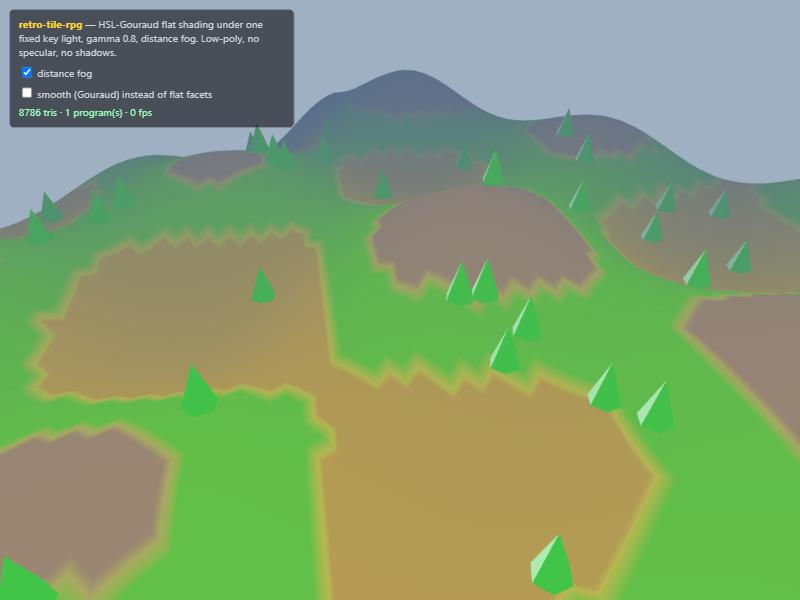

# retro-tile-rpg

The look and feel of the classic tile-based 3D RPGs — as a **portable recipe**, not a
clone. Two engine-agnostic techniques distilled from reverse-engineering research and
rebuilt as clean, dependency-free code:

1. **The look** — HSL-Gouraud flat shading under one fixed key light (this README + a
   working three.js material, verified in-browser).
2. **The world + movement** — a tile-region data model with directional collision and
   breadth-first click-to-move ([TILE-WORLD.md](TILE-WORLD.md), with a ready-to-use
   implementation linked).

No game assets, no cache data, no proprietary bytes — this is the *method*, applied to
your own meshes. Pick a permissive path and build your own world on it.



## The look, in one breath

What makes those worlds read the way they do isn't polygon count — it's the shading:

1. **Low poly, hard silhouettes** — hundreds of faces per model, not thousands.
2. **Colour is hue + saturation; brightness is 100% from lighting.** A face stores only
   its hue and saturation; its luminance is computed each frame from the light. That one
   fact is most of the look.
3. **One fixed directional key light** + a flat ambient floor. No second light, no
   specular, no shadows.
4. **Flat or Gouraud** per face — faceted geometry (non-indexed, face normals) gives the
   hard facets; smooth normals give the Gouraud variant. The originals mixed both.
5. **A brightness gamma** (`pow(rgb, ~0.8)`) puts the colours in that slightly muted band.
6. **Tiny textures** (64²/128²), nearest-filtered and tiled, used as albedo and modulated
   by the *same* luminance term.
7. **No post** beyond optional distance fog; a fixed, fairly top-down camera pitch.

Get those and it reads right in any engine.

## Use it (three.js)

`retro-flat-material.js` builds a `THREE.ShaderMaterial` that does exactly this. Feed each
vertex an `hs` attribute (hue, saturation ∈ 0..1) and it computes luminance from the
vertex normal against a fixed light, converts HSL→RGB, and applies the gamma.

```js
import * as THREE from 'three';
import { createRetroFlatMaterial, setFlatColor } from './retro-flat-material.js';

const geo = new THREE.ConeGeometry(1, 3, 6).toNonIndexed(); // non-indexed → hard facets
geo.computeVertexNormals();
setFlatColor(THREE, geo, 0.34, 0.6);                        // a green cone (hue, sat)

const mat = createRetroFlatMaterial(THREE, {
  ambient: 0.45, diffuse: 0.55, gamma: 0.8,
  lightDir: [-0.69, -0.14, -0.69],  // one fixed key light
  fog: true,                        // respect scene fog (set the uniforms, below)
});
scene.add(new THREE.Mesh(geo, mat));
```

### Two paths

- **Path A — static (recommended default).** Bake the lit colours into a `color` vertex
  attribute once and use a plain `MeshBasicMaterial({ vertexColors:true, flatShading:true })`.
  Free at runtime; exact. Use `bakeVertexColors(THREE, geometry, hue, sat, opts)` — it
  returns the geometry carrying a baked `color` attribute.
- **Path B — dynamic.** Use `createRetroFlatMaterial` when the light must move (day/night,
  relightable scenery). Slightly more cost, same look.

### Options

| Option | Default | What |
|---|---|---|
| `lightDir` | `[-0.69,-0.14,-0.69]` | the single fixed key-light direction (normalized inside) |
| `ambient` | `0.5` | flat ambient floor (0..1) |
| `diffuse` | `0.5` | key-light contribution (0..1) |
| `gamma` | `0.8` | brightness curve on the final RGB |
| `map` | – | a `THREE.Texture` used as albedo × luminance instead of HSL (nearest-filter + `RepeatWrapping` for the retro feel) |
| `fog` | `false` | add a distance-fog term; set `mat.uniforms.fogColor/fogNear/fogFar` |

**Flat vs. Gouraud:** feed non-indexed geometry with face normals for hard facets; feed
smooth normals for the Gouraud variant. (`geometry.toNonIndexed()` then
`computeVertexNormals()`.)

## The world and movement

The other half — a tile grid with per-edge collision and click-to-move — is written up as
an engine-agnostic spec in **[TILE-WORLD.md](TILE-WORLD.md)**: the data model, the
traversability test, the BFS route-finder (no corner-cutting, nearest-reachable fallback),
and the step-queue + interpolation that makes the walk smooth. A ready, verified three.js
implementation of all of it lives in the companion repo
[**three-pointclick**](https://github.com/iniGlowee/three-pointclick).

## Verification

The material was verified in a real browser (`shader-demo.html`, three.js from CDN):
procedural low-poly terrain + scattered trees shaded by the material — **one shader
program**, flat facets, height-banded HSL colours, distance fog dissolving the far hills
into the sky. The fog toggle adds/removes the fog term on the material; the static
`bakeVertexColors` path matches the shader on the CPU (saturation 0 → neutral grey =
`luminanceᵞ`; a green hue → green-dominant RGB). Run it: `python -m http.server` here,
open `shader-demo.html`, toggle fog and flat/smooth.

## IP note

This is portable technique only — no game art, meshes, textures, maps, or cache data, and
no game-specific constants beyond the illustrative light/gamma values above (tune them
freely). The exact derivations of the classic client's palette and lighting are documented
by the archival/runtime-client communities (e.g. OpenRS2, RuneLite); this repo reproduces
the *visual recipe* on your own meshes. Independent project, not affiliated with or
endorsed by any game's rights-holders.

## License

[MIT](LICENSE) — "retro-tile-rpg contributors". Distilled from the AE1 ("Angel's Egg")
browser engine's research; contains only this standalone reimplementation.
